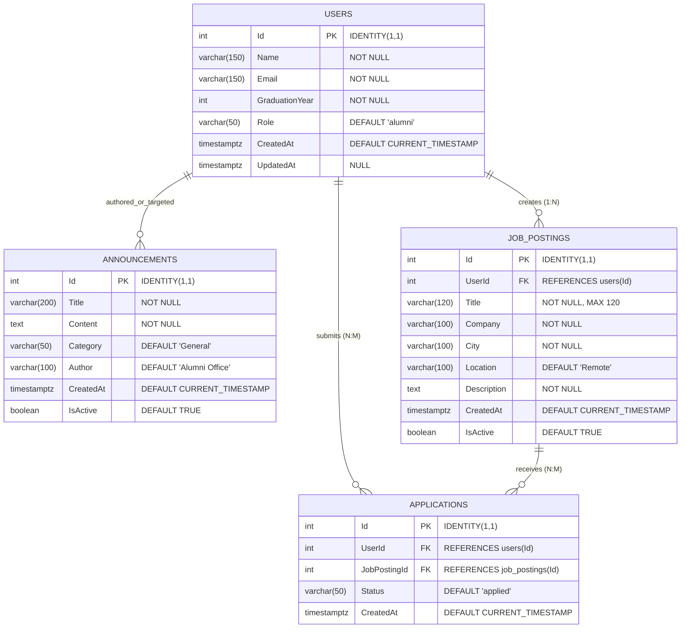

# 🗄️ Data Design Documentation (`ddd.md`)

> **Course**: Web Programming (Web Programlama) — Istanbul University  
> **Instructor**: Assoc. Prof. Dr. Emre Akadal  
> **Student**: Nazife Türk (`nazife.turk@ogr.iu.edu.tr`)  
> **Repository**: [https://github.com/NazifeTurk/alumni](https://github.com/NazifeTurk/alumni)  
> **Reference Link**: ⬅️ [Return to Main Documentation (README.md)](README.md)

---

## 📌 Executive Summary

This document serves as the formal **Data Design Documentation (`ddd.md`)** for the **Alumni Tracking System (`alumni`)**. It specifies the relational persistence layer, schema design, Entity Framework Core ORM mappings, environment variable secret boundaries, Factory/Seed data generation, and the empirical **Forgetting Test** verification required for the Week 05 milestone.

```text
 ┌────────────────────────────────────────────────────────────────────────┐
 │                      Alumni Tracking System                            │
 │                       Data Flow & Persistence Architecture             │
 └────────────────────────────────────┬───────────────────────────────────┘
                                      │
               HTTP Requests (JSON API / HTML Forms)
                                      ▼
            ┌──────────────────────────────────────────────────┐
            │         Dual Controllers (API & MVC Views)       │
            │  • ApiUserController        • UserController     │
            │  • ApiAnnouncementController • AnnouncementCtrl  │
            └─────────────────────────┬────────────────────────┘
                                      │
                    Dependency Injection (Interfaces)
                                      ▼
            ┌──────────────────────────────────────────────────┐
            │               CRUD Service Layer                 │
            │  • IUserService         ──► DbUserService        │
            │  • IAnnouncementService ──► DbAnnouncementService│
            └─────────────────────────┬────────────────────────┘
                                      │
                   ORM Data Context & Model Factories
                                      ▼
            ┌──────────────────────────────────────────────────┐
            │        Entity Framework Core (AlumniDbContext)   │
            │  • UserFactory           • AnnouncementFactory   │
            │  • DatabaseSeeder        • Npgsql Provider       │
            └─────────────────────────┬────────────────────────┘
                                      │
                  TCP Connection (Host=db;Port=5432)
                                      ▼
            ┌──────────────────────────────────────────────────┐
            │        PostgreSQL 16 Engine (Container)          │
            │       Tables: users, announcements               │
            └─────────────────────────┬────────────────────────┘
                                      │
                  Host Disk Mount (Docker Named Volume)
                                      ▼
            ┌──────────────────────────────────────────────────┐
            │    💾 Named Volume: postgres_data                │
            │    Target: /var/lib/postgresql/data              │
            │    (Persists across container down/up cycles)    │
            └──────────────────────────────────────────────────┘
```

---

## 🏛️ Database Engine Choice & Academic Defense

| Criteria | Choice: **PostgreSQL 16 (Alpine)** | Rationale & Defense |
| :--- | :--- | :--- |
| **Data Integrity** | Strict ACID Compliance | Enterprise-grade transaction guarantees prevent partial writes during alumni profile updates or simultaneous registrations. |
| **ORM Synergy** | Npgsql EF Core 7 | Exceptional first-class LINQ support, automatic sequence generation, and identity column synchronization. |
| **Future Extensibility** | Native JSONB & Full-Text Search | Future milestones requiring alumni resume parsing, skill tag searches, or unstructured metadata can leverage PostgreSQL's native `jsonb` without introducing a NoSQL store. |
| **Container Footprint** | `postgres:16-alpine` | Lightweight (~40 MB base image), fast cold-start (<5 seconds), and reproducible across all developer host operating systems via Docker Compose. |
| **Secret Management** | Parameterized Credentials | Complete separation between source code and connection secrets via `.env` files. |

---

## 📊 Entity-Relationship Diagram (ERD)



---

## 📋 Data Dictionary & Table Schemas

### 1. `users` Table (Alumni & System Members)
Stores registered graduates, administrative officers, and student profiles.

| Column Name | SQL Type | Nullable | Default | Constraints | Description |
| :--- | :--- | :---: | :--- | :--- | :--- |
| `Id` | `INTEGER` | ❌ No | `GENERATED BY DEFAULT AS IDENTITY` | **PRIMARY KEY** | Unique identifier for each user |
| `Name` | `VARCHAR(150)` | ❌ No | — | Max length 150 | Full name of the alumnus / user |
| `Email` | `VARCHAR(150)` | ❌ No | — | Valid email | Institutional or personal email |
| `GraduationYear`| `INTEGER` | ❌ No | — | `> 1900` | Graduation cohort year (e.g., 2026) |
| `Role` | `VARCHAR(50)` | ❌ No | `'alumni'` | Max length 50 | Authorization role (`alumni`, `admin`, `student`) |
| `CreatedAt` | `TIMESTAMPTZ` | ❌ No | `CURRENT_TIMESTAMP` | UTC timestamp | Record creation timestamp |
| `UpdatedAt` | `TIMESTAMPTZ` | ✅ Yes | `NULL` | UTC timestamp | Last modification timestamp |

### 2. `announcements` Table (Alumni Events & Opportunities)
Stores news, networking galas, and job mentorship opportunities.

| Column Name | SQL Type | Nullable | Default | Constraints | Description |
| :--- | :--- | :---: | :--- | :--- | :--- |
| `Id` | `INTEGER` | ❌ No | `GENERATED BY DEFAULT AS IDENTITY` | **PRIMARY KEY** | Unique identifier for the announcement |
| `Title` | `VARCHAR(200)` | ❌ No | — | Max length 200 | Concise title of the post |
| `Content` | `TEXT` | ❌ No | — | Unlimited text | Full markdown or HTML announcement body |
| `Category` | `VARCHAR(50)` | ❌ No | `'General'` | Max length 50 | Category (`Reunion`, `Mentorship`, `Career`, `General`) |
| `Author` | `VARCHAR(100)` | ❌ No | `'Alumni Office'` | Max length 100 | Authoring organization or coordinator |
| `CreatedAt` | `TIMESTAMPTZ` | ❌ No | `CURRENT_TIMESTAMP` | UTC timestamp | Publication timestamp |
| `IsActive` | `BOOLEAN` | ❌ No | `TRUE` | Boolean flag | Controls visibility on the public portal |

### 3. `job_postings` Table (One-to-Many: User -> Postings)
Stores job openings and internships created by verified alumni.

| Column Name | SQL Type | Nullable | Default | Constraints & Business Rules | Description |
| :--- | :--- | :---: | :--- | :--- | :--- |
| `Id` | `INTEGER` | ❌ No | `GENERATED BY DEFAULT AS IDENTITY` | **PRIMARY KEY** | Unique identifier for the job posting |
| `UserId` | `INTEGER` | ❌ No | — | **FOREIGN KEY** (`users.Id`) | Creator of the job posting |
| `Title` | `VARCHAR(120)` | ❌ No | — | **REQUIRED**, Max Length: **120** | Position / role title |
| `Company` | `VARCHAR(100)` | ❌ No | — | **REQUIRED**, Max Length: 100 | Employing company / institution |
| `City` | `VARCHAR(100)` | ❌ No | — | **REQUIRED**, Max Length: 100 | Target city / primary location |
| `Location` | `VARCHAR(100)` | ❌ No | `'Remote'` | Max Length: 100 | Workplace / Office address |
| `Description`| `TEXT` | ❌ No | — | Unlimited text | Role requirements & details |
| `CreatedAt` | `TIMESTAMPTZ` | ❌ No | `CURRENT_TIMESTAMP` | UTC timestamp | Creation timestamp |
| `IsActive` | `BOOLEAN` | ❌ No | `TRUE` | Boolean flag | Active hiring status |

> **📏 Validation Rules for Job Postings (Business Logic & Integrity Constraints):**  
> * **`Title` (Başlık)**: **REQUIRED** and **MAX 120 CHARACTERS**. Any payload missing a title, containing whitespace only, or exceeding 120 characters is rejected with **`HTTP 400 Bad Request`**.  
> * **`Company` (Şirket)**: **REQUIRED**. The employer company name must be provided; missing or empty value returns **`HTTP 400 Bad Request`**.  
> * **`City` (Şehir)**: **REQUIRED**. The city/region where the role is based must be specified (e.g. `'Istanbul'`, `'Ankara'`, `'Remote'`). Missing or empty value returns **`HTTP 400 Bad Request`**.  

> **⚖️ Delete Rule Decision: `ON DELETE RESTRICT`**  
> *Academic Defense*: When an alumnus user profile is deleted or deactivated, their existing job postings and associated student applications are **NOT** deleted (`RESTRICT`). Deleting an active job posting simply because the poster's profile changed would invalidate ongoing candidate applications and corrupt historical job telemetry. Attempting to delete a user with active job postings returns **`HTTP 409 Conflict`**. If account removal is requested, soft-deactivation or manual re-assignment is required.

### 4. `applications` Table (Many-to-Many Join: Users <-> JobPostings)
Manages candidate applications submitted by alumni and students for job postings.

| Column Name | SQL Type | Nullable | Default | Constraints | Description |
| :--- | :--- | :---: | :--- | :--- | :--- |
| `Id` | `INTEGER` | ❌ No | `GENERATED BY DEFAULT AS IDENTITY` | **PRIMARY KEY** | Unique identifier for application row |
| `UserId` | `INTEGER` | ❌ No | — | **FOREIGN KEY** (`users.Id`) | Candidate applicant |
| `JobPostingId` | `INTEGER` | ❌ No | — | **FOREIGN KEY** (`job_postings.Id`) | Applied job opening |
| `Status` | `VARCHAR(50)` | ❌ No | `'applied'` | Max length 50 | Status (`applied`, `interview`, `accepted`, `rejected`) |
| `CreatedAt` | `TIMESTAMPTZ` | ❌ No | `CURRENT_TIMESTAMP` | UTC timestamp | Application submission timestamp |

> **🔒 Unique Constraint & Conflict Handling (`UNIQUE(UserId, JobPostingId)`):**  
> A candidate cannot apply twice to the same job opening. PostgreSQL enforces `UNIQUE (user_id, job_posting_id)`. Attempting to submit a duplicate application results in an **`HTTP 409 Conflict`** response.

---

## 🛣️ Relational API & Nested Routing Architecture

### A. Nested Creation Route (`POST /api/users/:id/jobs`)
* The creator `id` is specified as a **URL Path Parameter** (`/api/users/1/jobs`).
* The request payload **only** contains job details (`{"title": "Junior Developer", "company": "Acme", "city": "Istanbul"}`). The body never says whose posting it is—the URL dictates identity.
* Validates job posting rules:
  * Missing title $\rightarrow$ **`400 Bad Request`**
  * Title $> 120$ characters $\rightarrow$ **`400 Bad Request`**
  * Missing company $\rightarrow$ **`400 Bad Request`**
  * Missing city $\rightarrow$ **`400 Bad Request`**
* The controller verifies user existence:
  * If user does NOT exist $\rightarrow$ **`404 Not Found`** (`{"error": 404, "message": "User with ID '...' was not found."}`).
  * If user exists $\rightarrow$ `INSERT INTO job_postings (user_id, title, company, city) VALUES (1, ...)` and returns **`201 Created`**.

### B. Include Pattern — One Answer, Two Tables (`GET /api/users/:id`)
* Executes an SQL `LEFT JOIN`:
  ```sql
  SELECT * FROM users
  LEFT JOIN job_postings ON job_postings.user_id = users.id
  WHERE users.id = :id;
  ```
* Output returns the user object with an embedded `"jobs"` collection:
  ```json
  {
    "id": 1,
    "name": "Ada",
    "jobs": [
      { "id": 10, "title": "Backend Intern", "company": "Tech Corp" },
      { "id": 11, "title": "Data Analyst", "company": "Data Insights" },
      { "id": 13, "title": "Junior Developer", "company": "Acme" }
    ]
  }
  ```

### C. Application Submission (`POST /api/jobs/:id/applications`)
* Request body: `{"userId": 3}`
* Checks user exists (`404` if not) and job exists (`404` if not).
* If candidate has already applied to this posting $\rightarrow$ **`409 Conflict`** (`{"error": 409, "message": "User has already applied to this job posting"}`).
* On success $\rightarrow$ **`201 Created`**.

### D. Custom Logging Middleware (`RequestLoggingMiddleware`)
Implemented in `src/middlewares/RequestLoggingMiddleware.cs` and injected at the entry of the HTTP pipeline in `Program.cs`. It benchmarks and prints every incoming request to the terminal stdout in a clean single line:
* **Log Pattern**: `time method route restype duration`
* **Real-time Terminal Output Example**:
  ```text
  10:20:30 POST /user 201 18ms
  07:02:00 POST /api/users 201 228ms
  07:02:06 GET /api/jobs 200 124ms
  ```
* **Performance Telemetry**: Uses `System.Diagnostics.Stopwatch` to track elapsed execution time with millisecond precision without degrading throughput.

### E. 404 Guardian Middleware (`NotFoundGuardianMiddleware`)
Implemented in `src/middlewares/NotFoundGuardianMiddleware.cs` and registered with `app.UseNotFoundGuardian()` in `Program.cs`. It guards the entire application against raw or unexplained 404 errors by intercepting any 404 response in the pipeline and returning a structured JSON response that explicitly includes a descriptive **`reason`**:
* **Payload Structure**:
  ```json
  {
    "status": "error",
    "code": 404,
    "reason": "User with ID '99999' was not found.",
    "path": "/api/users/99999",
    "method": "GET",
    "timestamp": "2026-11-11T07:31:01.8951959Z",
    "hint": "Check endpoint syntax, verify resource IDs, or explore available endpoints at /api/swagger."
  }
  ```
* **Domain-Aware Reason Determination**:
  * Unregistered URL path $\rightarrow$ Explains that the route does not exist for the specified HTTP verb.
  * Non-existent Entity ID $\rightarrow$ Identifies the missing entity type (User, JobPosting, Announcement).
  * Missing Parent in Nested Route $\rightarrow$ Clarifies that the parent author/user does not exist for nested creation.

### F. 5xx Guardian Middleware (`ServerErrorGuardianMiddleware`)
Implemented in `src/middlewares/ServerErrorGuardianMiddleware.cs` and registered with `app.UseServerErrorGuardian()` in `Program.cs`. It acts as the enterprise crash protector, catching all unhandled exceptions and 5xx errors across the pipeline, guarding sensitive internal credentials and stack traces while returning a structured JSON response with a specific **`reason`** and diagnostic **`traceId`**:
* **Payload Structure**:
  ```json
  {
    "status": "error",
    "code": 500,
    "title": "Internal Server Error",
    "reason": "An unhandled InvalidOperationException was caught by the 5xx Guardian: Simulation of an internal server exception.",
    "path": "/api/test/500",
    "method": "GET",
    "traceId": "00-8ef9a94bd1cac168ebc47ba3d0c82923-ae62cc700850b95c-00",
    "timestamp": "2026-11-11T07:36:51.9020373Z",
    "hint": "The server encountered an internal failure. If the problem persists, share the traceId with the system administrator."
  }
  ```
* **Security & Observability**:
  * Protects database connection strings, database schemas, and filesystem paths from exposure.
  * Correlates logs using `traceId` (`Activity.Current?.Id ?? context.TraceIdentifier`).
  * Collaborates with `RequestLoggingMiddleware` to maintain continuous audit telemetry in the terminal.

### G. Persistent File Error Logging (`Log --> logs/error.logs`)
All runtime errors (4xx client rejections, 404 missing routes, 5xx server exceptions) are automatically persisted to disk in **`logs/error.logs`** via `src/services/FileErrorLogger.cs`:
* **File Target**: `logs/error.logs` (volume-mounted into Docker via `./logs:/app/logs`).
* **Log Entry Pattern**:
  ```text
  [YYYY-MM-DD HH:mm:ss] [STATUS] METHOD PATH - Reason: <reason> [TraceId: <traceId>]
    Exception: <ExceptionType>: <Message>
    StackTrace: <trace>
  ```
* **Real Example from `logs/error.logs`**:
  ```text
  [2026-11-11 07:45:39] [500] GET /api/test/500 - Reason: An unhandled InvalidOperationException was caught by the 5xx Guardian: Simulation of an internal server exception for 5xx Guardian verification. [TraceId: 00-73c0be6203fc846d9374e622e4f0ef33-5928fde903bbb4a3-00]
    Exception: System.InvalidOperationException: Simulation of an internal server exception for 5xx Guardian verification.
    StackTrace: at Program.<>c.<<Main>$>b__0_4() in /src/src/Program.cs:line 104
  [2026-11-11 07:45:39] [404] GET /api/users/99999 - Reason: User with ID '99999' was not found. [TraceId: 0HNPVOV3R0Q5D:00000001]
  [2026-11-11 07:45:39] [400] POST /api/users - Reason: HTTP 400 Client Error (21ms) [TraceId: 0HNPVOV3R0Q5E:00000001]
  ```

### H. Generic 404 Page & Invalid Request Redirection (`define generic 404 page and redirect invalid request`)
A dedicated, responsive, university-themed generic 404 page is integrated to handle invalid web traffic gracefully:
* **HTML View**: `src/views/404.html` containing Istanbul University alumni branding, glowing badge, animated glitch header, navigation links (Home, Jobs, Users, Announcements, Swagger), and dynamic path interpolation (`{{REQUESTED_PATH}}`).
* **Deployment Packaging**: `src/Alumni.csproj` includes `<Content Include="views/**">` ensuring automatic deployment into `/app/views/` across Docker and production build stages.
* **Endpoint `GET /404`**: Mapped in `src/routes/BasicRoutes.cs`. Reads `views/404.html`, injects the requested URL path securely with HTML encoding, and responds with `HTTP 404 Not Found` (`text/html; charset=utf-8`).
* **Invalid Request Redirection**:
  * Unmapped browser/web requests (e.g. `GET /invalid-page`, `GET /unknown`) hit `app.MapFallback` or `NotFoundGuardianMiddleware` and are redirected via **`HTTP 302 Found`** to `/404?requestedPath=<escaped-path>`.
  * Following the redirect displays the styled 404 error page while accurately informing the client of `HTTP 404 Not Found`.
* **Preservation of API JSON Contract**:
  * API endpoints (`/api/...`) bypass HTML redirection and continue returning structured JSON payloads with `"reason"`, preserving Postman and integration test compatibility.
* **Auditing & Logging**:
  * Every invalid request redirect and 404 page render is logged to `logs/error.logs` via `FileErrorLogger` and output in single-line format to the console via `RequestLoggingMiddleware`.

### I. Postman Automated Invalid Requests Test Suite (`postman_alumni_invalid_requests.json`)
The project provides an automated, regression-proof Postman test collection located at **`postman_alumni_invalid_requests.json`** targeting client error handling, domain validation rules, relational foreign key constraints, and server crash protection:

| # | Test Scenario | Method & Endpoint | Payload / Params | Status | Postman Test Assertions |
|---|:---|:---|:---|:---:|:---|
| **1** | Missing Required Field | `POST /api/users` | `{"email": "...", "graduationYear": 2024}` | `400` | Verifies `400 Bad Request` and error mentions `Name`. |
| **2** | Malformed JSON Syntax | `POST /api/users` | `{"name": "Broken", "email": ...` (unclosed) | `400` | Verifies parser catches malformed syntax before binding. |
| **3** | Type Mismatch | `POST /api/users` | `{"graduationYear": "not-a-number"}` | `400` | Verifies string-for-integer failure is rejected. |
| **4** | Missing Title & Company | `POST /api/users/1/jobs` | `{"description": "...", "location": "Istanbul"}` | `400` | Verifies nested route rejects payload without Title/Company. |
| **4b**| Title Exceeds 120 Chars | `POST /api/users/1/jobs` | Title with $>120$ characters | `400` | Verifies JobPosting rule: Title maximum 120 characters. |
| **4c**| Missing City | `POST /api/users/1/jobs` | `{"title": "...", "company": "..."}` | `400` | Verifies JobPosting rule: City is required. |
| **5** | Non-Existent User ID | `GET /api/users/99999` | None | `404` | Verifies 404 Guardian JSON with `"reason"`. |
| **6** | Nested Route with Missing User | `POST /api/users/99999/jobs` | Valid Job Payload | `404` | Explains parent user entity not found in database. |
| **7** | Apply to Non-Existent Job | `POST /api/jobs/99999/applications` | `{"userId": 1}` | `404` | Explains job posting does not exist. |
| **8** | Apply with Non-Existent User | `POST /api/jobs/10/applications` | `{"userId": 99999}` | `404` | Explains candidate user does not exist. |
| **9** | Duplicate Job Application | `POST /api/jobs/10/applications` | `{"userId": 3}` (second time) | `409` | Enforces `UNIQUE(user_id, job_posting_id)`. |
| **10**| Delete User with Active Jobs | `DELETE /api/users/1` | None | `409` | Enforces `ON DELETE RESTRICT` foreign key integrity. |
| **11**| Plain Text to JSON Endpoint | `POST /api/users` | `Content-Type: text/plain` | `415` | Rejects payload without `application/json`. |
| **12**| 5xx Server Exception Interception | `GET /api/test/500` | None | `500` | Verifies 5xx Guardian returns `reason` and `traceId`. |

---

## 🔐 Environment Variables & Secrets Policy (Board Item ④)

In compliance with the 12-Factor App methodology and security requirements:
* **`.env` is strictly git-ignored** in `.gitignore` to prevent database passwords or sensitive configuration leaks to public repositories.
* **`.env.example`** and **`.example.env`** are committed to version control to provide zero-guesswork templates for team members and graders.

### Environment Variable Mapping Table:
| Variable | Default (Local / Example) | Purpose |
| :--- | :--- | :--- |
| `APP_ENV` | `development` | ASP.NET Core environment mode |
| `APP_PORT` | `8000` | Host port exposed for web traffic |
| `APP_SECRET` | `supersecretkey_change_in_production` | Application encryption & signing secret |
| `DB_HOST` | `db` | Docker internal DNS host for PostgreSQL service |
| `DB_PORT` | `5432` | Internal database port |
| `DB_NAME` | `alumni_db` | Primary relational database name |
| `DB_USER` | `alumni_user` | Non-root application database user |
| `DB_PASSWORD` | `alumni_password` | Database credentials |
| `DATABASE_URL`| `postgresql://alumni_user:alumni_password@db:5432/alumni_db` | Fully-qualified connection string |

---

## 🏭 Factory & Seed Architecture (Board Item ⑥)

To ensure deterministic, realistic baseline data upon database initialization:
1. **`UserFactory` (`src/Data/Factories/UserFactory.cs`)**:
   Provides static factory methods `Create(...)` and `CreateDefaultAlumni()` to generate validated `User` domain entities with canonical email formats (`name.surname@ogr.iu.edu.tr`).
2. **`AnnouncementFactory` (`src/Data/Factories/AnnouncementFactory.cs`)**:
   Generates baseline university event records (`2026 Annual Alumni Homecoming Gala`, `Tech Mentorship Cohort 2026 Applications Open`).
3. **`DatabaseSeeder` (`src/Data/DatabaseSeeder.cs`)**:
   Checks whether the database tables contain existing records. If empty, it persists default factory entities and resynchronizes PostgreSQL primary key identity sequences using `pg_get_serial_sequence` to prevent primary key collisions on subsequent `POST` requests.

---

## 🔄 CRUD Interfaces with Database Connection (Board Item ⑦)

The architecture decouples HTTP transport from data storage using explicit C# interfaces registered in the ASP.NET Core IoC container:

```csharp
// Program.cs Service Registration:
builder.Services.AddScoped<IUserService, DbUserService>();
builder.Services.AddScoped<IAnnouncementService, DbAnnouncementService>();
```

* **`IUserService`** (`src/Services/IUserService.cs`):
  Implemented by **`DbUserService`**, handling queries and mutations via `AlumniDbContext.Users`.
* **`IAnnouncementService`** (`src/Services/IAnnouncementService.cs`):
  Implemented by **`DbAnnouncementService`**, handling queries and mutations via `AlumniDbContext.Announcements`.
* Both **API Controllers** (`ApiUserController`, `ApiAnnouncementController`) and **View Controllers** (`UserController`, `AnnouncementController`) consume these interfaces, ensuring single-source-of-truth persistence.

---

## 🧪 The Forgetting Test (Board Item ①)

The **Forgetting Test** is the empirical benchmark proving that records survive complete container destructions (`docker compose down`).

### 1. Step 1: Create a Record (`create a record`)
```bash
curl -X POST http://localhost:8000/api/users \
  -H "Content-Type: application/json" \
  -d '{"name":"Nazife Turk Forgetting Test","email":"nazife.turk.test@ogr.iu.edu.tr","graduationYear":2026,"role":"Alumni Lead"}'
```
*HTTP Response (`201 Created`):*
```json
{
  "id": 48,
  "name": "Nazife Turk Forgetting Test",
  "email": "nazife.turk.test@ogr.iu.edu.tr",
  "graduationYear": 2026,
  "role": "Alumni Lead",
  "createdAt": "2026-10-14T08:10:57.124447Z",
  "updatedAt": null
}
```

### 2. Step 2: Destroy and Recreate Stack (`docker compose down && up`)
```bash
docker compose down && docker compose up -d
```
*Action*: Both application container and database container are stopped and deleted. Memory (RAM) is completely freed.

### 3. Step 3: Check the Record (`check the record`)
```bash
curl -s http://localhost:8000/api/users/48
```
*HTTP Response (`200 OK`):*
```json
{
  "id": 48,
  "name": "Nazife Turk Forgetting Test",
  "email": "nazife.turk.test@ogr.iu.edu.tr",
  "graduationYear": 2026,
  "role": "Alumni Lead",
  "createdAt": "2026-10-14T08:10:57.124447Z",
  "updatedAt": null
}
```
**Test Verdict**: ✅ **PASSED**. The record was recovered intact from the named volume `postgres_data`.

---

## 🔗 Cross-Documentation Link
* 📖 [Main Project Documentation (README.md)](README.md)
* ⚡ [Live Swagger UI](http://localhost:8000/api/swagger)
