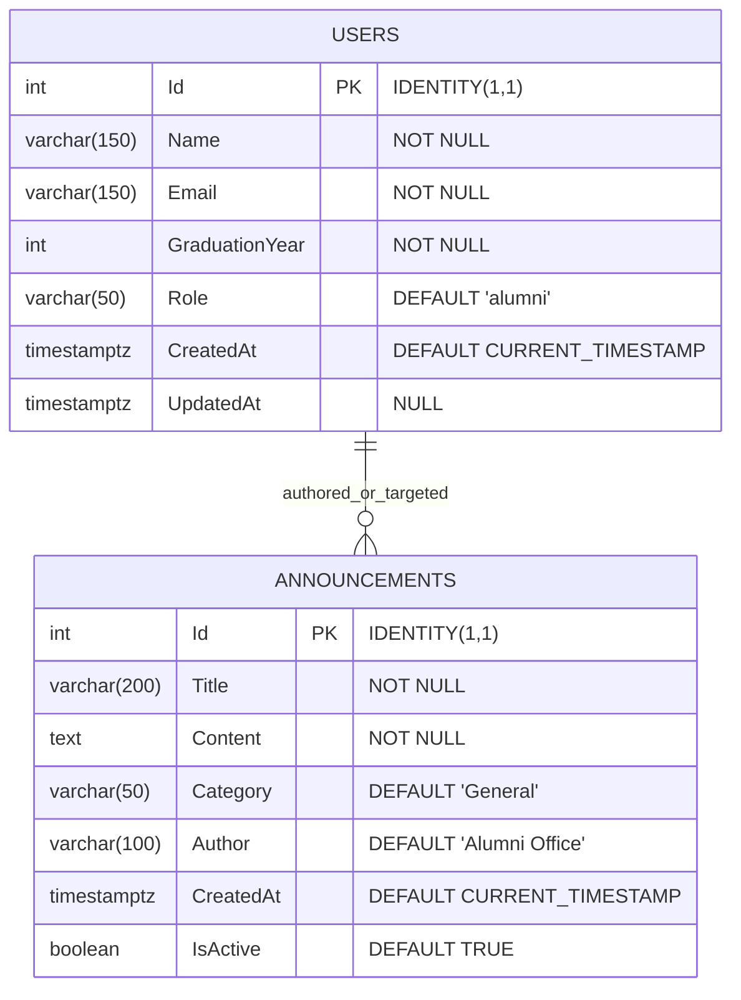

# 🗄️ Data Design Documentation (`ddd.md`)

> **Course**: Web Programming (Web Programlama) — Istanbul University  
> **Instructor**: Assoc. Prof. Dr. Emre Akadal  
> **Student**: Nazife Türk (`nazife.turk@ogr.iu.edu.tr`)  
> **Repository**: [https://github.com/NazifeTurk/alumni](https://github.com/NazifeTurk/alumni)  
> **Reference Link**: ⬅️ [Return to Main Documentation (README.md)](README.md)

---

## 📌 Executive Summary

This document serves as the formal **Data Design Documentation (`ddd.md`)** for the **Alumni Tracking System (`alumni`)**. It specifies the relational persistence layer, schema design, Entity Framework Core ORM mappings, environment variable secret boundaries, Factory/Seed data generation, and the empirical **Forgetting Test** verification required for the Week 05 milestone.

```text
 ┌────────────────────────────────────────────────────────────────────────┐
 │                      Alumni Tracking System                            │
 │                       Data Flow & Persistence Architecture             │
 └────────────────────────────────────┬───────────────────────────────────┘
                                      │
               HTTP Requests (JSON API / HTML Forms)
                                      ▼
            ┌──────────────────────────────────────────────────┐
            │         Dual Controllers (API & MVC Views)       │
            │  • ApiUserController        • UserController     │
            │  • ApiAnnouncementController • AnnouncementCtrl  │
            └─────────────────────────┬────────────────────────┘
                                      │
                    Dependency Injection (Interfaces)
                                      ▼
            ┌──────────────────────────────────────────────────┐
            │               CRUD Service Layer                 │
            │  • IUserService         ──► DbUserService        │
            │  • IAnnouncementService ──► DbAnnouncementService│
            └─────────────────────────┬────────────────────────┘
                                      │
                   ORM Data Context & Model Factories
                                      ▼
            ┌──────────────────────────────────────────────────┐
            │        Entity Framework Core (AlumniDbContext)   │
            │  • UserFactory           • AnnouncementFactory   │
            │  • DatabaseSeeder        • Npgsql Provider       │
            └─────────────────────────┬────────────────────────┘
                                      │
                  TCP Connection (Host=db;Port=5432)
                                      ▼
            ┌──────────────────────────────────────────────────┐
            │        PostgreSQL 16 Engine (Container)          │
            │       Tables: users, announcements               │
            └─────────────────────────┬────────────────────────┘
                                      │
                  Host Disk Mount (Docker Named Volume)
                                      ▼
            ┌──────────────────────────────────────────────────┐
            │    💾 Named Volume: postgres_data                │
            │    Target: /var/lib/postgresql/data              │
            │    (Persists across container down/up cycles)    │
            └──────────────────────────────────────────────────┘
```

---

## 🏛️ Database Engine Choice & Academic Defense

| Criteria | Choice: **PostgreSQL 16 (Alpine)** | Rationale & Defense |
| :--- | :--- | :--- |
| **Data Integrity** | Strict ACID Compliance | Enterprise-grade transaction guarantees prevent partial writes during alumni profile updates or simultaneous registrations. |
| **ORM Synergy** | Npgsql EF Core 7 | Exceptional first-class LINQ support, automatic sequence generation, and identity column synchronization. |
| **Future Extensibility** | Native JSONB & Full-Text Search | Future milestones requiring alumni resume parsing, skill tag searches, or unstructured metadata can leverage PostgreSQL's native `jsonb` without introducing a NoSQL store. |
| **Container Footprint** | `postgres:16-alpine` | Lightweight (~40 MB base image), fast cold-start (<5 seconds), and reproducible across all developer host operating systems via Docker Compose. |
| **Secret Management** | Parameterized Credentials | Complete separation between source code and connection secrets via `.env` files. |

---

## 📊 Entity-Relationship Diagram (ERD)



---

## 📋 Data Dictionary & Table Schemas

### 1. `users` Table (Alumni & System Members)
Stores registered graduates, administrative officers, and student profiles.

| Column Name | SQL Type | Nullable | Default | Constraints | Description |
| :--- | :--- | :---: | :--- | :--- | :--- |
| `Id` | `INTEGER` | ❌ No | `GENERATED BY DEFAULT AS IDENTITY` | **PRIMARY KEY** | Unique identifier for each user |
| `Name` | `VARCHAR(150)` | ❌ No | — | Max length 150 | Full name of the alumnus / user |
| `Email` | `VARCHAR(150)` | ❌ No | — | Valid email | Institutional or personal email |
| `GraduationYear`| `INTEGER` | ❌ No | — | `> 1900` | Graduation cohort year (e.g., 2026) |
| `Role` | `VARCHAR(50)` | ❌ No | `'alumni'` | Max length 50 | Authorization role (`alumni`, `admin`, `student`) |
| `CreatedAt` | `TIMESTAMPTZ` | ❌ No | `CURRENT_TIMESTAMP` | UTC timestamp | Record creation timestamp |
| `UpdatedAt` | `TIMESTAMPTZ` | ✅ Yes | `NULL` | UTC timestamp | Last modification timestamp |

### 2. `announcements` Table (Alumni Events & Opportunities)
Stores news, networking galas, and job mentorship opportunities.

| Column Name | SQL Type | Nullable | Default | Constraints | Description |
| :--- | :--- | :---: | :--- | :--- | :--- |
| `Id` | `INTEGER` | ❌ No | `GENERATED BY DEFAULT AS IDENTITY` | **PRIMARY KEY** | Unique identifier for the announcement |
| `Title` | `VARCHAR(200)` | ❌ No | — | Max length 200 | Concise title of the post |
| `Content` | `TEXT` | ❌ No | — | Unlimited text | Full markdown or HTML announcement body |
| `Category` | `VARCHAR(50)` | ❌ No | `'General'` | Max length 50 | Category (`Reunion`, `Mentorship`, `Career`, `General`) |
| `Author` | `VARCHAR(100)` | ❌ No | `'Alumni Office'` | Max length 100 | Authoring organization or coordinator |
| `CreatedAt` | `TIMESTAMPTZ` | ❌ No | `CURRENT_TIMESTAMP` | UTC timestamp | Publication timestamp |
| `IsActive` | `BOOLEAN` | ❌ No | `TRUE` | Boolean flag | Controls visibility on the public portal |

---

## 🔐 Environment Variables & Secrets Policy (Board Item ④)

In compliance with the 12-Factor App methodology and security requirements:
* **`.env` is strictly git-ignored** in `.gitignore` to prevent database passwords or sensitive configuration leaks to public repositories.
* **`.env.example`** and **`.example.env`** are committed to version control to provide zero-guesswork templates for team members and graders.

### Environment Variable Mapping Table:
| Variable | Default (Local / Example) | Purpose |
| :--- | :--- | :--- |
| `APP_ENV` | `development` | ASP.NET Core environment mode |
| `APP_PORT` | `8000` | Host port exposed for web traffic |
| `APP_SECRET` | `supersecretkey_change_in_production` | Application encryption & signing secret |
| `DB_HOST` | `db` | Docker internal DNS host for PostgreSQL service |
| `DB_PORT` | `5432` | Internal database port |
| `DB_NAME` | `alumni_db` | Primary relational database name |
| `DB_USER` | `alumni_user` | Non-root application database user |
| `DB_PASSWORD` | `alumni_password` | Database credentials |
| `DATABASE_URL`| `postgresql://alumni_user:alumni_password@db:5432/alumni_db` | Fully-qualified connection string |

---

## 🏭 Factory & Seed Architecture (Board Item ⑥)

To ensure deterministic, realistic baseline data upon database initialization:
1. **`UserFactory` (`src/Data/Factories/UserFactory.cs`)**:
   Provides static factory methods `Create(...)` and `CreateDefaultAlumni()` to generate validated `User` domain entities with canonical email formats (`name.surname@ogr.iu.edu.tr`).
2. **`AnnouncementFactory` (`src/Data/Factories/AnnouncementFactory.cs`)**:
   Generates baseline university event records (`2026 Annual Alumni Homecoming Gala`, `Tech Mentorship Cohort 2026 Applications Open`).
3. **`DatabaseSeeder` (`src/Data/DatabaseSeeder.cs`)**:
   Checks whether the database tables contain existing records. If empty, it persists default factory entities and resynchronizes PostgreSQL primary key identity sequences using `pg_get_serial_sequence` to prevent primary key collisions on subsequent `POST` requests.

---

## 🔄 CRUD Interfaces with Database Connection (Board Item ⑦)

The architecture decouples HTTP transport from data storage using explicit C# interfaces registered in the ASP.NET Core IoC container:

```csharp
// Program.cs Service Registration:
builder.Services.AddScoped<IUserService, DbUserService>();
builder.Services.AddScoped<IAnnouncementService, DbAnnouncementService>();
```

* **`IUserService`** (`src/Services/IUserService.cs`):
  Implemented by **`DbUserService`**, handling queries and mutations via `AlumniDbContext.Users`.
* **`IAnnouncementService`** (`src/Services/IAnnouncementService.cs`):
  Implemented by **`DbAnnouncementService`**, handling queries and mutations via `AlumniDbContext.Announcements`.
* Both **API Controllers** (`ApiUserController`, `ApiAnnouncementController`) and **View Controllers** (`UserController`, `AnnouncementController`) consume these interfaces, ensuring single-source-of-truth persistence.

---

## 🧪 The Forgetting Test (Board Item ①)

The **Forgetting Test** is the empirical benchmark proving that records survive complete container destructions (`docker compose down`).

### 1. Step 1: Create a Record (`create a record`)
```bash
curl -X POST http://localhost:8000/api/users \
  -H "Content-Type: application/json" \
  -d '{"name":"Nazife Turk Forgetting Test","email":"nazife.turk.test@ogr.iu.edu.tr","graduationYear":2026,"role":"Alumni Lead"}'
```
*HTTP Response (`201 Created`):*
```json
{
  "id": 48,
  "name": "Nazife Turk Forgetting Test",
  "email": "nazife.turk.test@ogr.iu.edu.tr",
  "graduationYear": 2026,
  "role": "Alumni Lead",
  "createdAt": "2026-10-14T08:10:57.124447Z",
  "updatedAt": null
}
```

### 2. Step 2: Destroy and Recreate Stack (`docker compose down && up`)
```bash
docker compose down && docker compose up -d
```
*Action*: Both application container and database container are stopped and deleted. Memory (RAM) is completely freed.

### 3. Step 3: Check the Record (`check the record`)
```bash
curl -s http://localhost:8000/api/users/48
```
*HTTP Response (`200 OK`):*
```json
{
  "id": 48,
  "name": "Nazife Turk Forgetting Test",
  "email": "nazife.turk.test@ogr.iu.edu.tr",
  "graduationYear": 2026,
  "role": "Alumni Lead",
  "createdAt": "2026-10-14T08:10:57.124447Z",
  "updatedAt": null
}
```
**Test Verdict**: ✅ **PASSED**. The record was recovered intact from the named volume `postgres_data`.

---

## 🔗 Cross-Documentation Link
* 📖 [Main Project Documentation (README.md)](README.md)
* ⚡ [Live Swagger UI](http://localhost:8000/api/swagger)
